<h1 align="center">Nox Aeterna</h1>

<em>A gothic dark theme for Obsidian, inspired by the Night Lords.</em>

English · <a href="README.zh-CN.md">简体中文</a>

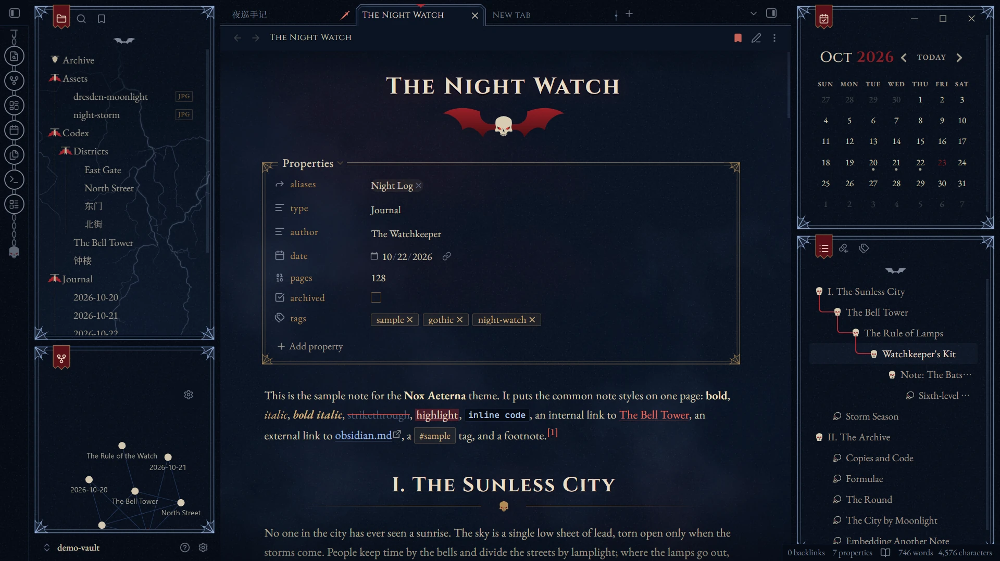

## Features

- Dark only.
- Typography for English and Simplified Chinese, with automatic CJK–Latin spacing.
- Fonts are embedded, so the theme works offline and makes no network requests.
- 35 Style Settings options, with a settings page in English or Chinese. Most decorations can be turned off.
- Built for the desktop app and tested on Obsidian 1.14 (Windows).

## Screenshots

Taken with the sample vault in [`demo-vault/`](demo-vault). Open that folder as a vault to try the theme.

### Notes

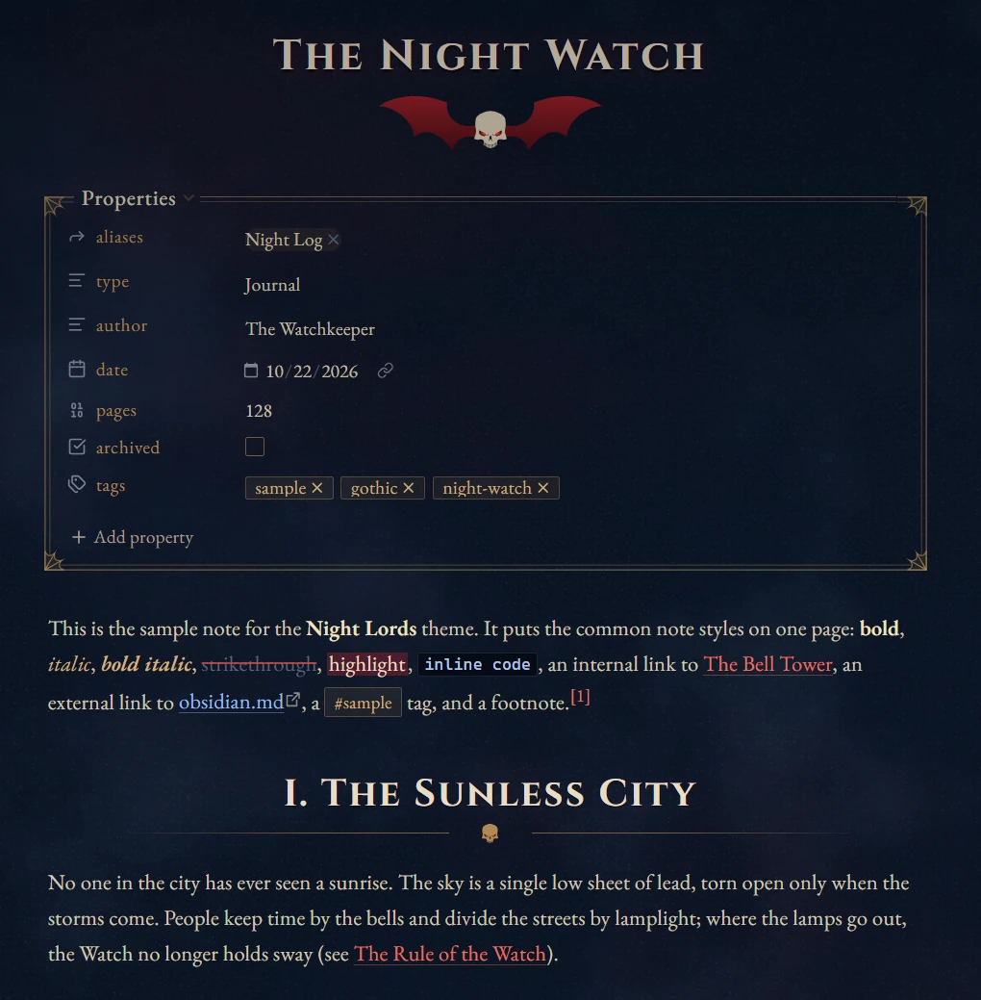

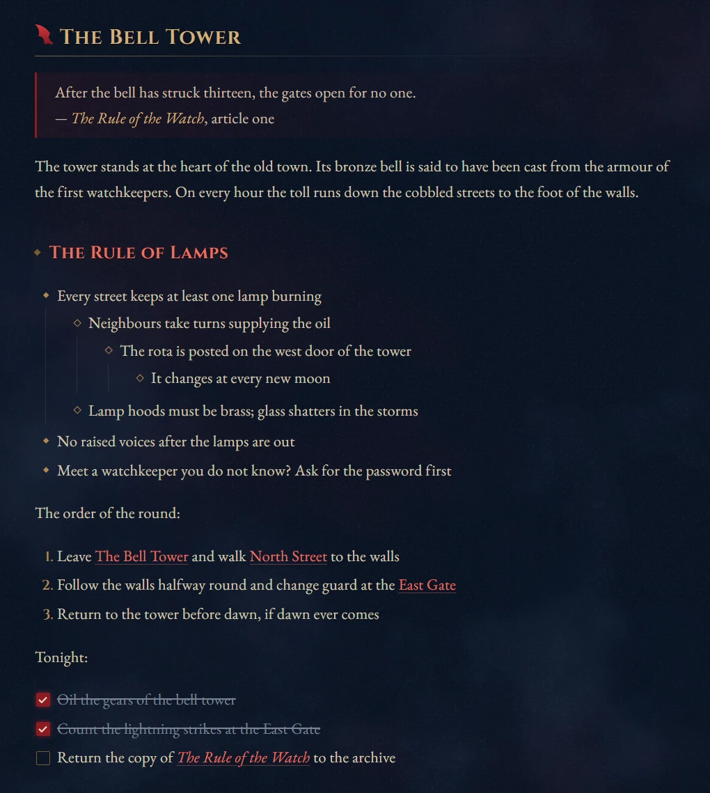

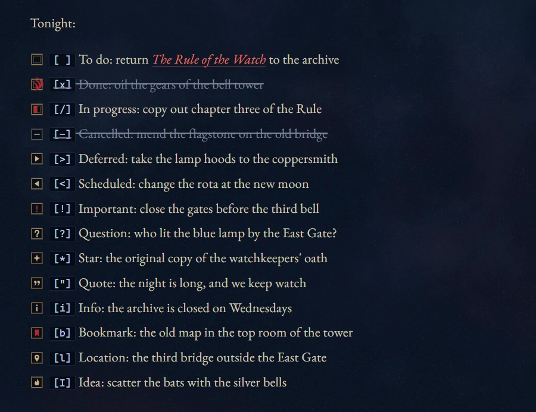

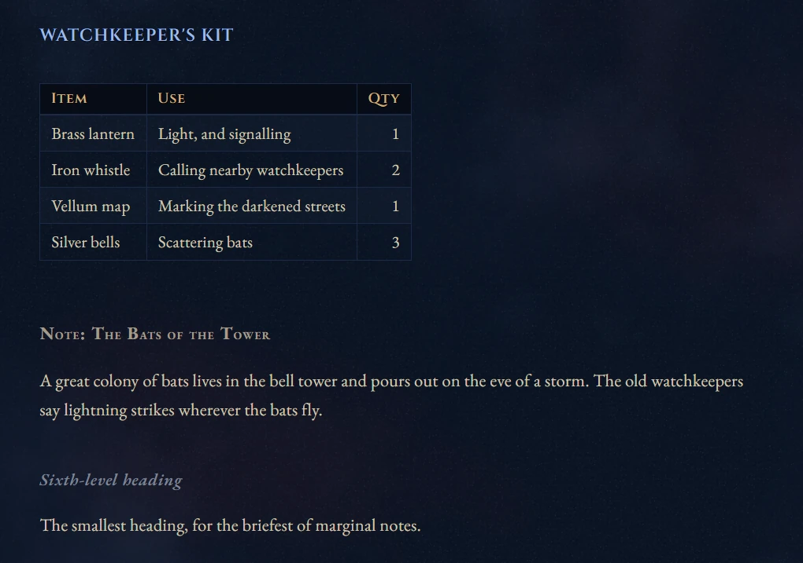

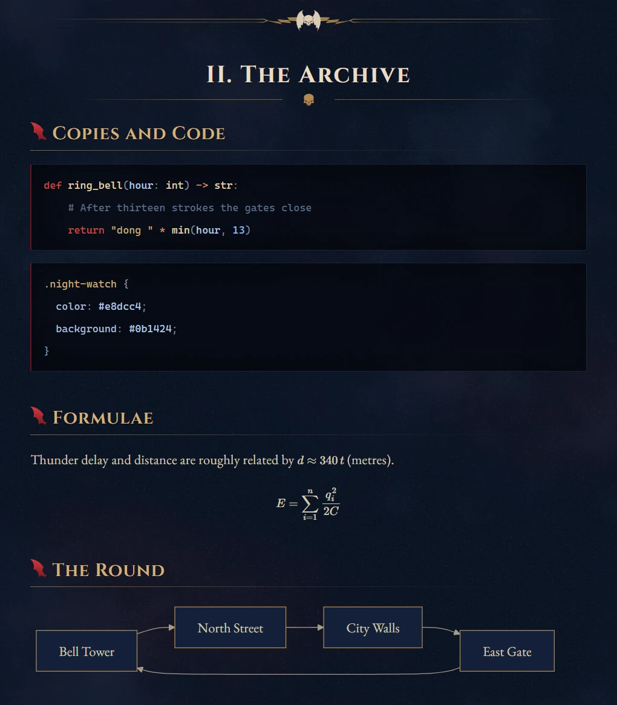

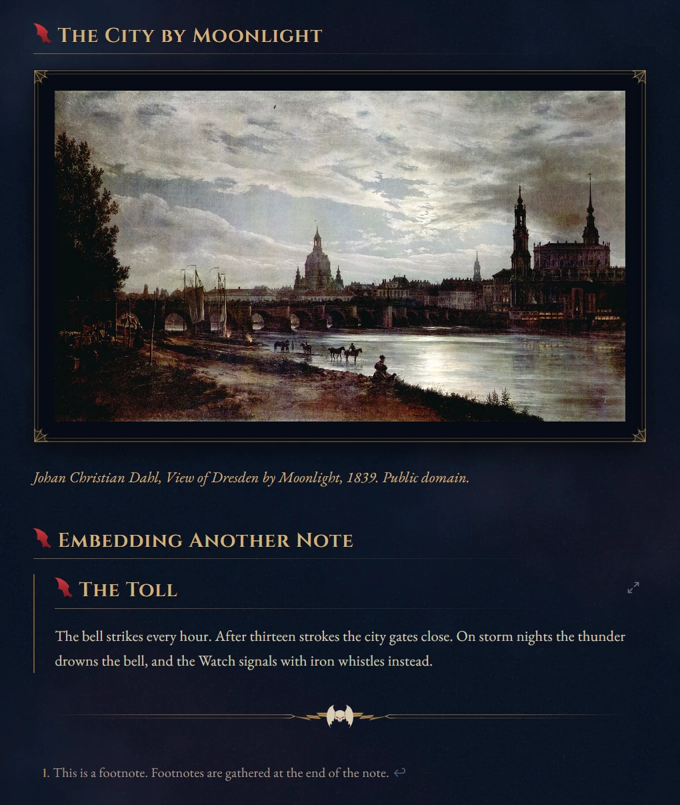

Add `|noframe` after an image to leave that image unframed.

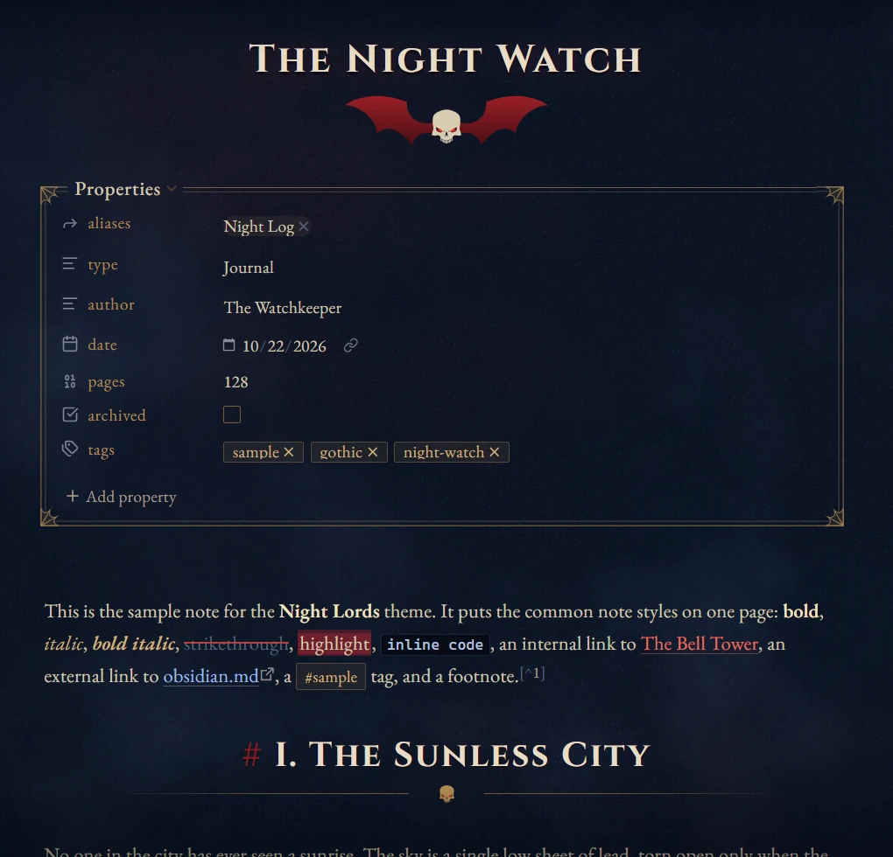

### Callouts

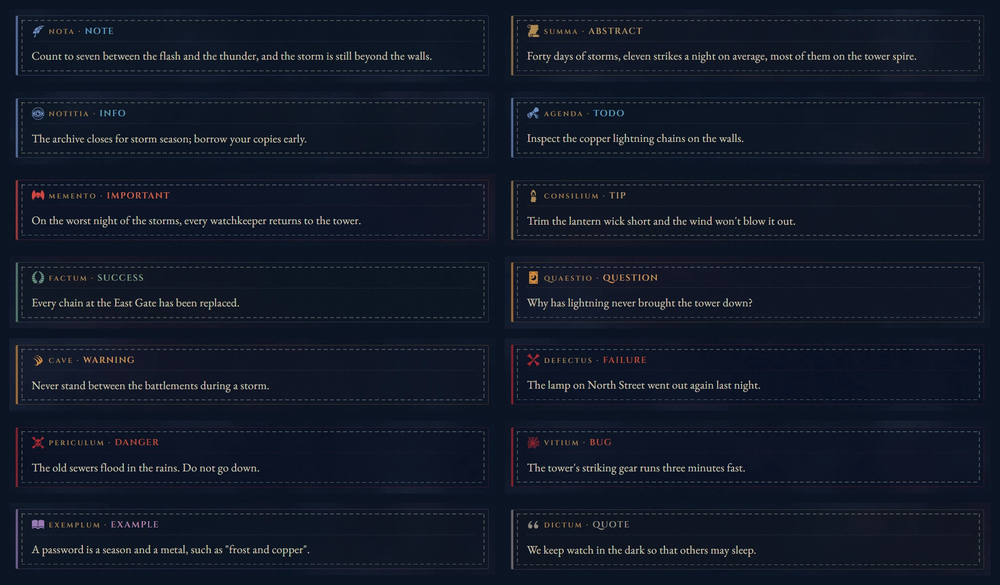

### Sidebars and tabs

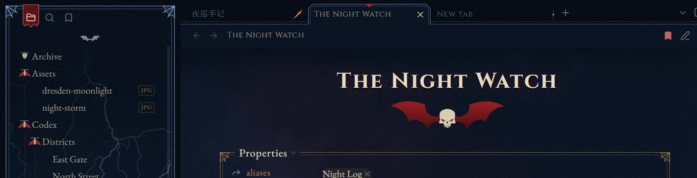

  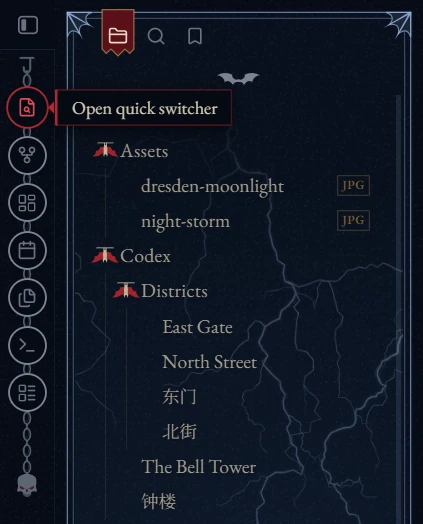
  &nbsp;&nbsp;
  

### Dialogs and empty tabs

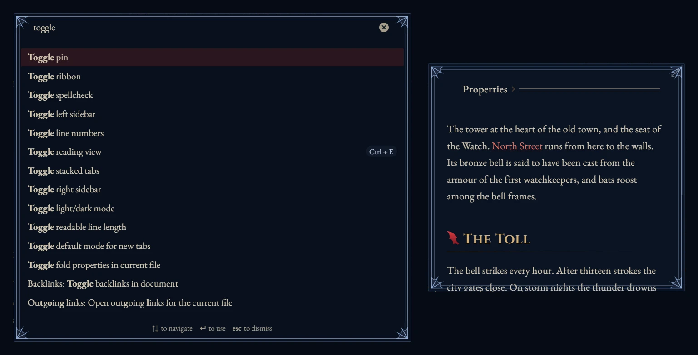

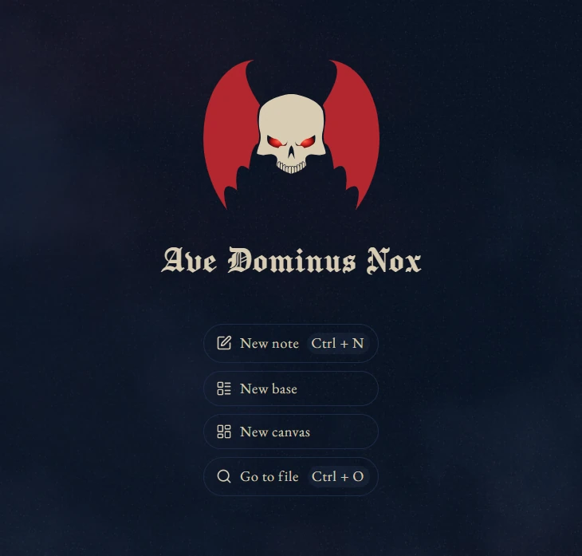

## Installation

**From Obsidian:** go to *Settings → Appearance → Themes → Manage*, search for **Nox Aeterna**, then choose *Install and use*.

**Manually:** copy `theme.css` and `manifest.json` into `<your vault>/.obsidian/themes/Nox Aeterna/`, then select the theme in *Settings → Appearance*.

**Recommended:**

- Install the [Style Settings](https://github.com/mgmeyers/obsidian-style-settings) plugin. All options live there; without it the theme uses its defaults.
- Set *Settings → Appearance → Base color scheme* to **Dark**, which plugins such as Excalidraw follow.

## Style Settings

*Settings language* at the top of the page switches it between English and Chinese. Defaults are in parentheses.

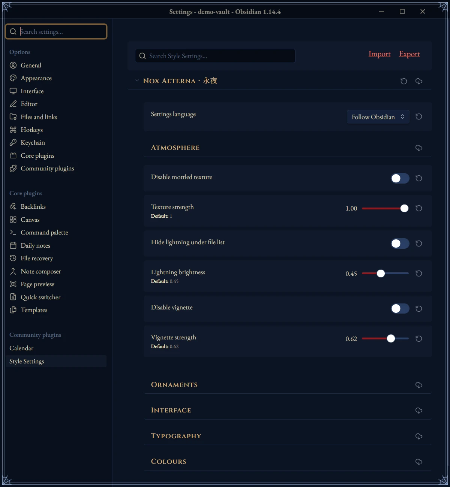

| Group | Options |
|---|---|
| Atmosphere | Texture and its strength (1) · Lightning under the file list and its brightness (0.45) · Vignette and its strength (0.62) |
| Ornaments | Title ornament · Heading ornaments · Ornamental horizontal rule · Callout decoration · Callout Latin labels · Card frames · Sidebar card spacing (8 px) · Themed or native callout icons · Folder icons (3 styles) · Outline style (3 styles) · Image style (3 styles) · Themed or native task checkboxes · Left-aligned H1 and note title |
| Interface | Auto-hide view header · Auto-hide ribbon · Auto-hide vault switcher · Auto-collapse sidebar buttons (on). Hidden items reappear on hover. |
| Typography | Chinese heading font (Noto Serif SC / Huiwen Mincho, installed separately / STSong) · Body line height (1.85) · Body alignment · CJK–Latin spacing · Latin curly quotes · Sans-serif interface |
| Colours | Accent `#b3262e` · Links `#e8705f` · Brass `#d2b07a` · Lightning blue `#9dbbe8` · Note background `#0b1424` |

## Compatibility

- Desktop only. Mobile has not been tested.
- Chinese text uses Noto Serif SC / Source Han Serif if installed, otherwise an embedded subset of 6,763 common characters.
- A few effects need Chromium 135 or later, which comes with the Obsidian 1.12 installer or newer (see *Settings → About*). Older installers get simpler fallbacks.
- Common Mermaid diagram types are recoloured. Colours you set with `classDef` or `style` still take precedence.
- `theme.css` is about 5 MB because the fonts are embedded.

## Credits

- **Inspiration:** [Fancy-a-Story](https://github.com/ElsaTam/obsidian-fancy-a-story), [Baseline](https://github.com/aaaaalexis/obsidian-baseline), [Maple](https://github.com/subframe7536/obsidian-theme-maple).
- **Icons** by Lorc from [game-icons.net](https://game-icons.net), [CC BY 3.0](https://creativecommons.org/licenses/by/3.0/), modified: batwing-emblem, quill, scroll-unfurled, semi-closed-eye, tied-scroll, candle-light, laurels, claw-slashes, crossed-bones, skull-crossed-bones, spider-web, open-book, stiletto.
- **Artwork:** Heritage Library (HTC Heritage Type) for the outline skull; ICOOON MONO for the tarot card and the hollow skull; the community "wh_icons" set for the Night Lords emblem.
- **Fonts** (SIL Open Font License 1.1): EB Garamond, Cinzel, Manufacturing Consent, Noto Serif SC.

## Disclaimer

This is an unofficial fan work. *Warhammer 40,000*, the Night Lords and their emblem are trademarks of Games Workshop Ltd. The theme is not endorsed by or affiliated with Games Workshop.

## License

The theme code is released under the [MIT License](LICENSE). Third-party material keeps its own licenses; see [THIRD-PARTY-NOTICES.md](THIRD-PARTY-NOTICES.md).
