<h1 align="center">Nox Aeterna · 永夜</h1>

<em>身披午夜，雷电缠身。一款古典哥特风格的 Obsidian 暗色主题，灵感来自《战锤 40K》的午夜领主。</em>

<a href="README.md">English</a> · 简体中文

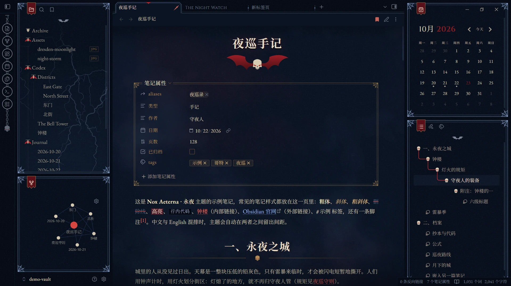

## 主题风格

Nox Aeterna 是拉丁语的「永夜」，灵感来自《战锤 40K》的第八军团午夜领主。他们来自诺斯特拉莫，一颗永不见日出的星球。军团的动力甲是午夜蓝色，绘着游走的闪电，挂着骨骸与蝙蝠翼。主题借用这套纹章，再按旧式印刷书籍的规矩排版。

- **配色**：深午夜蓝底色，骨白正文，黄铜装饰，血红点缀，界面线框用淡电光蓝。不用纯黑，也不用纯白。
- **字体**：古典书籍排版。西文正文用 EB Garamond，标题用 Cinzel 大写，中文用思源宋体；空白标签页上有一行哥特黑体字题铭。
- **装饰**：用几种平涂颜色画成的纹章剪影：笔记标题下的翼骷髅、二级标题旁扬起的单翼，分隔线换成闪电与骷髅组成的饰条。
- **Dark Deco 线框**：侧栏面板、弹窗、属性框和图片都套着细双线框，四角是蝙蝠翼扇形角花。结构取自装饰艺术（Art Deco），母题是哥特式的。
- **氛围**：淡淡的斑驳纹理、柔和的暗角，文件列表底部还有一道分叉闪电，强度都可以调低或关闭。
- **阅读处克制**：装饰只放在标题、边缘和线框上，正文保持朴素，行距放宽到 1.85。

**一览**

- 只有暗色。亮色模式下同样显示为暗色。
- 兼顾中英文排版：中西文之间自动加间距，中文标点用中文字形。
- Style Settings 设置页可显示中文或英文。
- 完全离线：字体、纹理、图标全部内嵌，不发出任何网络请求。
- 34 项 Style Settings 选项，大部分装饰都可以关掉，或换回 Obsidian 原版样式。
- 为桌面端设计，在 Obsidian 1.14（Windows）上测试。

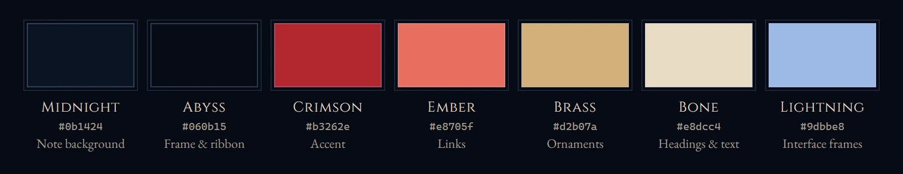

## 效果一览

以下截图都是在 Obsidian 1.14 里用示例库 [`demo-vault/`](demo-vault) 截的。把这个文件夹当作仓库打开，就能亲手试一遍所有样式。

### 笔记

笔记标题下挂着翼骷髅，属性框是铜色双线框，「笔记属性」几个字嵌在上框线里。一级标题居中，下方是带小骷髅的饰线。内部链接为余烬红，外部链接为电光蓝，高亮为血红。

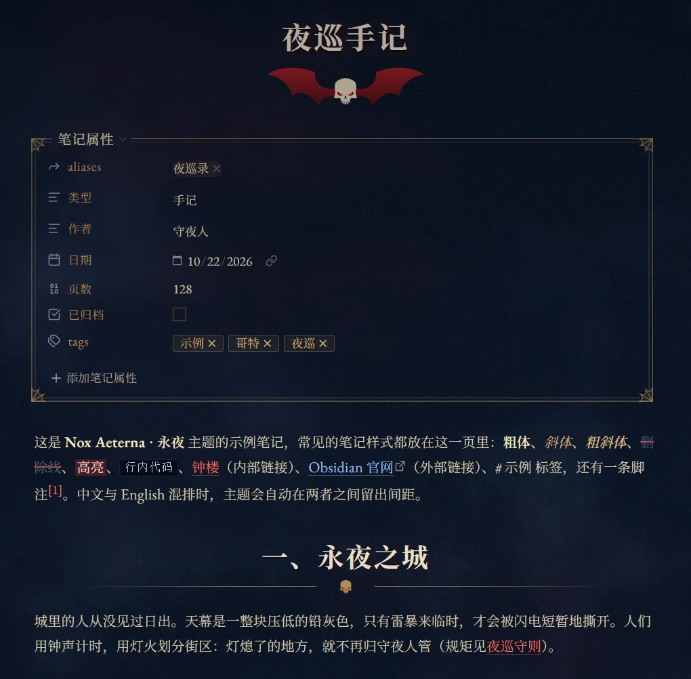

二级标题旁有一只扬起的血红单翼，三级标题前是一枚铜色菱形。引用块左侧是血红竖条。多级列表一级用铜色实心菱形，往下用空心菱形；已完成的任务打上血红勾并划掉。

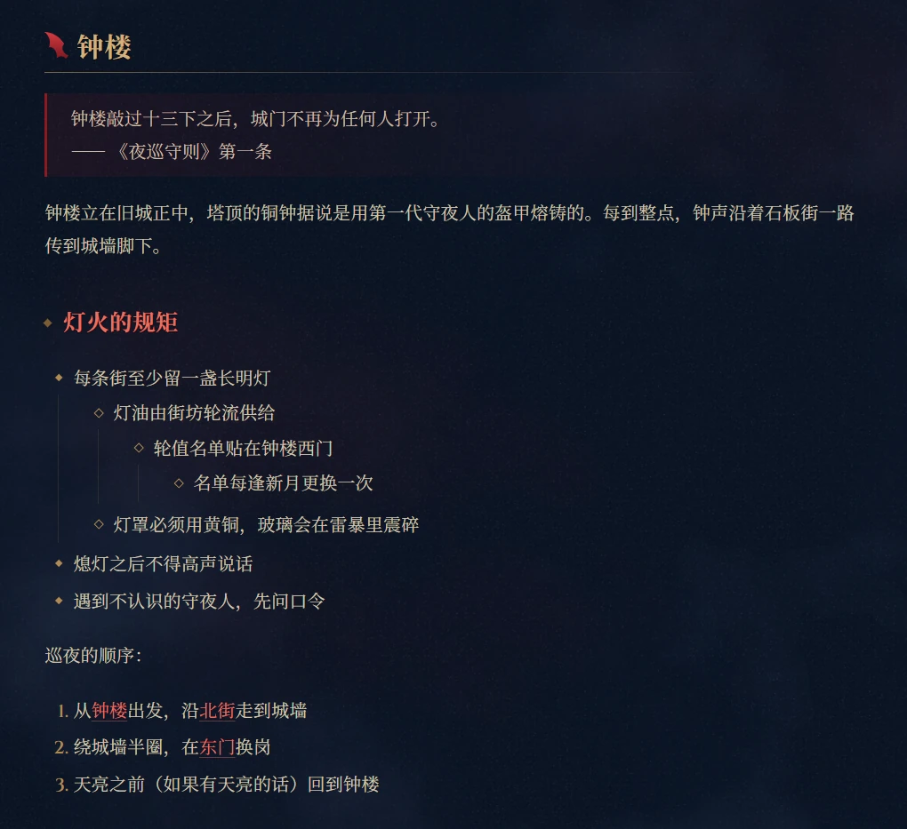

表格表头用深色底和小型大写字母。四到六级标题依次从电光蓝过渡到灰色斜体。

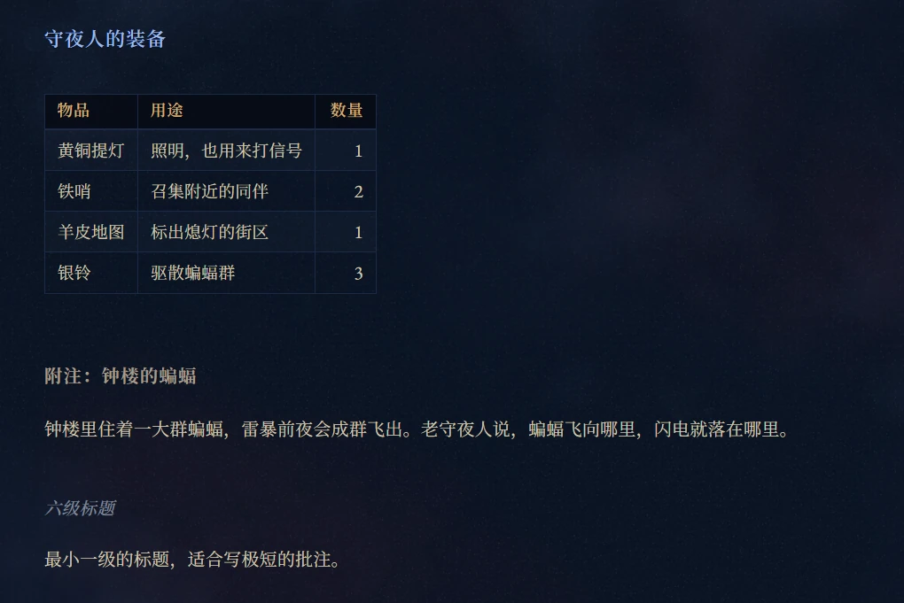

分隔线是闪电与骷髅组成的饰条。代码块放在更深的底板上，左侧有一道血红边。Mermaid 图也换成主题配色：夜蓝色方框、黄铜边框，起点和注释用血红色。

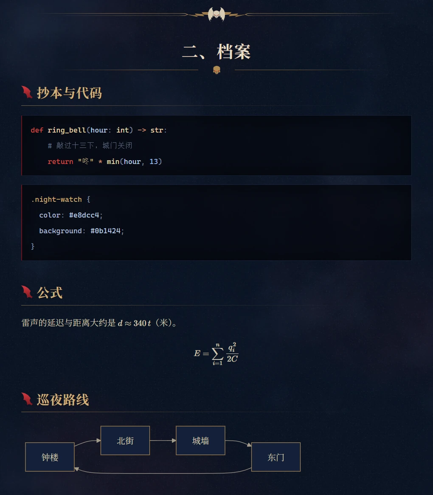

图片装进和属性框同一副铜框里，四周衬一圈深色底；也可以改成四边渐隐的夜色晕边，或换回原版。单张图片后面写 `|noframe` 就不加框。嵌入的笔记左侧有铜色竖条，脚注集中在最后一道分隔线下面。

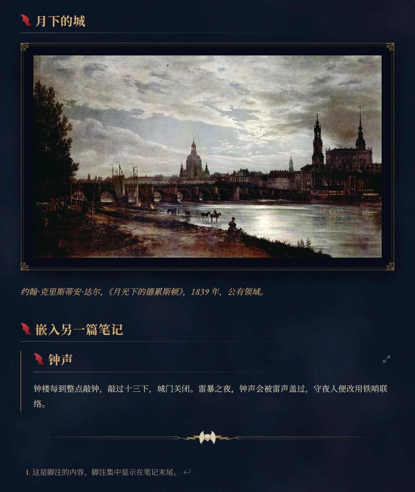

实时预览（编辑视图）下的样子和阅读视图保持一致。

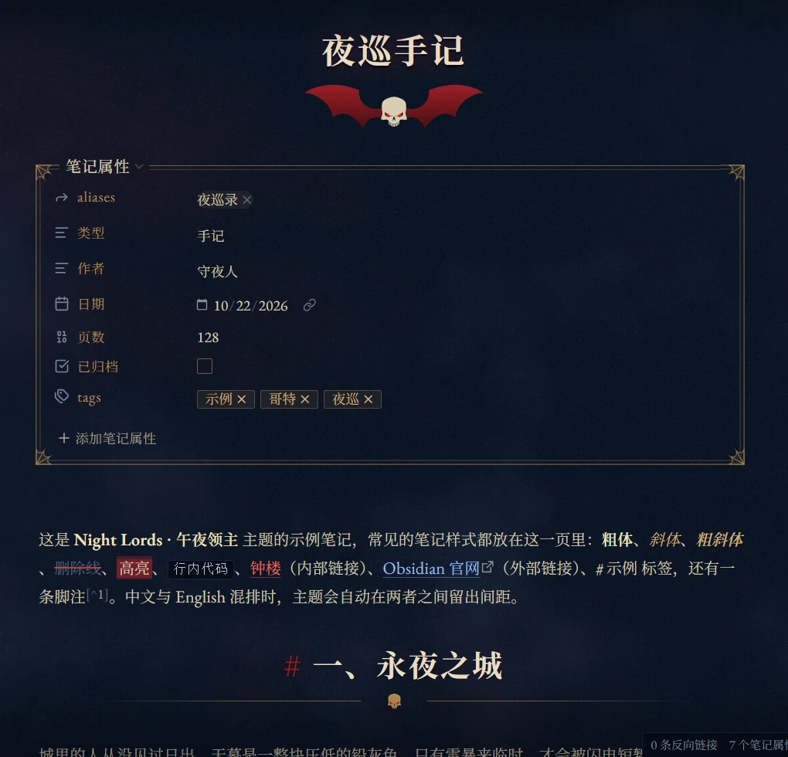

### Callout

每种 Callout 都有自己的剪影图标：笔记是羽毛笔，疑问是塔罗月牌，警告是三道爪痕，故障是蛛网。

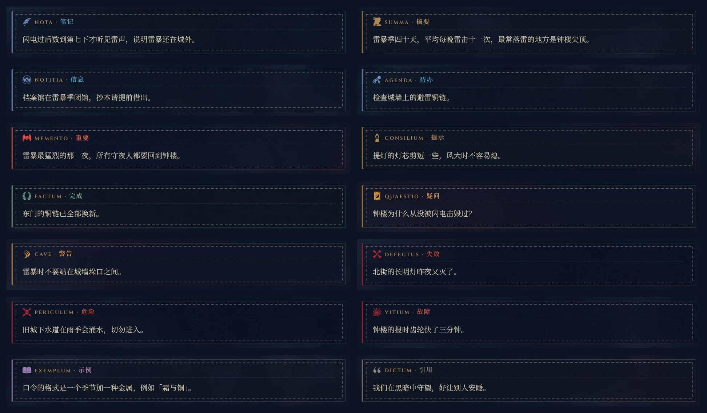

Callout 默认像一块缝在页面上的皮：框内一圈骨白针脚，标题下也是一道缝线，标题前加一行铜色拉丁小字（笔记是 NOTA，警告是 CAVE，疑问是 QUAESTIO……）。缝线和拉丁铭牌都可以单独关掉。

### 侧栏与标签

每个侧栏面板都是一张带框的卡片，当前的侧栏标签上挂着一面军团战旗。主区的当前标签切去两角，顶边正中有一枚血红尖饰；锁定的标签显示一把匕首。卡片四周的留白可在 0 到 24 px 之间调节。

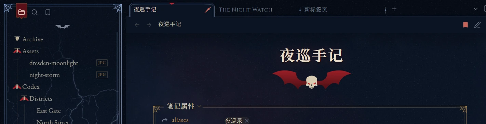

左侧功能栏是一串铁环锁链，末端坠着一枚铁骷髅；鼠标悬停时铁环变成血红，提示框带一道血红印记。右侧是侧栏面板顶部的按钮行：平时收成一对蝙蝠翼，悬停时展开。文件列表、大纲、书签、标签、反向链接等面板都适用，搜索框照常可用。

  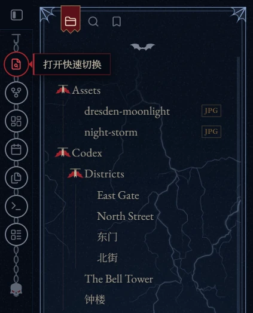
  &nbsp;&nbsp;
  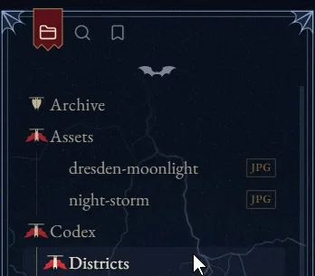

文件夹图标有三种可选：倒挂的蝙蝠（展开文件夹时张开血红翼膜）、铜色文件夹，或 Obsidian 原版箭头。

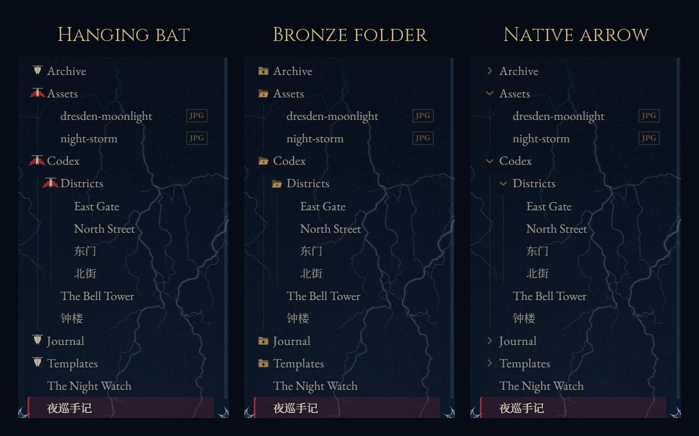

大纲里每个标题前都有一枚骷髅。鼠标悬停某个标题时，血线从它的各级上级标题一路流到这里。也可以换成跟随鼠标滑动的简单指示线，或 Obsidian 原版大纲。

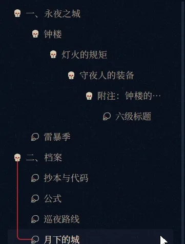

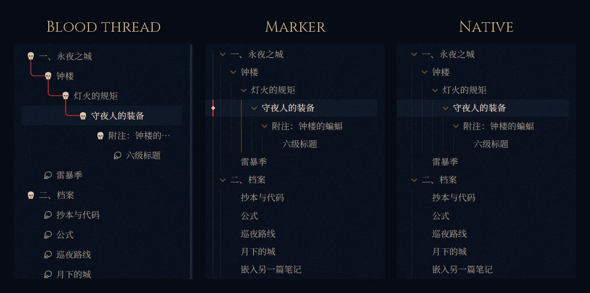

### 弹窗与空白标签页

命令面板、设置页和悬浮预览都用侧栏卡片同款线框。

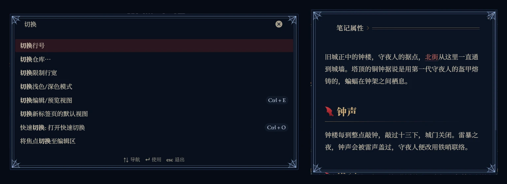

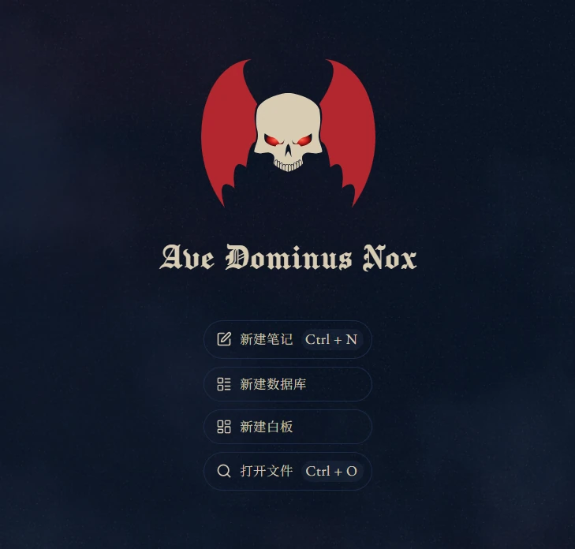

### 自动隐藏（可选）

以下四项都在 Style Settings 的「界面」分组里：

| 选项 | 效果 |
|---|---|
| 自动隐藏正文顶栏 | 带前进 / 后退按钮和路径的顶栏平时收起，鼠标移到笔记顶边时滑出。兼容 Editing Toolbar 插件的顶部模式。 |
| 自动隐藏左侧功能栏 | 鼠标移到窗口左边缘时功能栏滑出，并把左侧栏往右推开，不会盖住它。 |
| 自动隐藏左下角仓库栏 | 左侧栏底部显示仓库名的那一行，悬停时才出现。 |
| 自动收起侧栏面板按钮行 | 侧栏按钮行收成一对蝙蝠翼（见上图）。默认开启。 |

## 安装

**在 Obsidian 里安装**：打开「设置 → 外观 → 主题 → 管理」，搜索 **Nox Aeterna**，点「安装并使用」。

**手动安装**：把 `theme.css` 和 `manifest.json` 复制到 `<你的库>/.obsidian/themes/Nox Aeterna/`，再到「设置 → 外观」里选择本主题。

**建议**：

- 安装 [Style Settings](https://github.com/mgmeyers/obsidian-style-settings) 插件，所有选项都在里面。不装也能用，主题按默认值显示，只是侧栏按钮行不会收起。
- 把「设置 → 外观 → 基础颜色方案」设为**暗色**。Excalidraw 等插件按它决定配色。

## Style Settings 选项

设置页最上面的「设置语言」可以把设置页切换成中文或英文，也可以跟随 Obsidian 的界面语言。括号里是默认值。

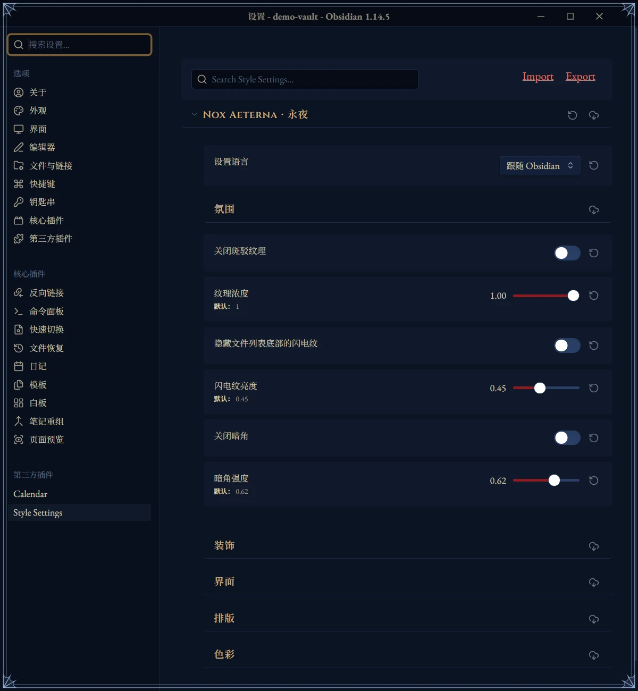

| 分组 | 选项 |
|---|---|
| 氛围 | 斑驳纹理及浓度（1）· 文件列表底部闪电纹及亮度（0.45）· 暗角及强度（0.62） |
| 装饰 | 标题下的翼骷髅 · 标题装饰 · 装饰分隔线 · Callout 装饰 · Callout 拉丁铭牌 · Dark Deco 卡片框 · 侧栏卡片留白（8 px）· Callout 主题图标 / 原版图标 · 文件夹图标（倒挂蝙蝠 / 铜色文件夹 / 原版箭头）· 大纲面板样式（血线 / 简单指示线 / 原版）· 图片样式（铜框画匾 / 夜色晕边 / 原版）· H1 与笔记标题左对齐 |
| 界面 | 自动隐藏正文顶栏 · 自动隐藏左侧功能栏 · 自动隐藏左下角仓库栏 · 自动收起侧栏面板按钮行（开） |
| 排版 | 标题中文字体（思源宋体 / 汇文明朝体 / 华文宋体）· 正文行距（1.85）· 正文对齐（左对齐 / 两端对齐）· 中西文自动间距 · 弯引号用西文字形 · 界面使用无衬线字体 |
| 色彩 | 主强调色 `#b3262e` · 链接色 `#e8705f` · 黄铜 `#d2b07a` · 电光蓝 `#9dbbe8` · 笔记底色 `#0b1424` |

## 字体

| 用途 | 字体 |
|---|---|
| 西文正文 | EB Garamond（内嵌） |
| 西文标题 | Cinzel（内嵌） |
| 中文 | 优先使用本机安装的思源宋体（Noto Serif SC / Source Han Serif）；没有安装时用内嵌的 6763 个常用字子集，子集之外的字由系统宋体补上 |
| 中文标点 “ ” … — · | 取自思源宋体的字形，不会落到西文字形上 |
| 空白页题铭 | Manufacturing Consent（Textura 哥特黑体，内嵌） |

标题中文字体还可以选汇文明朝体，需要自行安装。

## 兼容性

- **Obsidian 版本**：按 Obsidian 1.14 桌面端开发。移动端未测试；自动隐藏选项和功能栏锁链只在桌面端生效。
- **安装包版本**：少数效果取决于 Chromium 内核版本。内核随 Obsidian **安装包**而不是应用版本更新，版本号可在「设置 → 关于」中查看。1.12 安装包自带 Chromium 142，所有效果都能显示。旧安装包会有以下退化：
  - Chromium 125 以下：血线改为逐段绘制；简单指示线变成当前标题上的一条固定竖线，不再跟随鼠标滑动。
  - Chromium 135 以下：设置页下拉框的选项只显示英文。
  - Chromium 129 以下：左下角仓库栏展开时没有滑动动画，直接出现。
- **Mermaid**：流程图、时序图、类图、状态图、ER 图、甘特图、饼图、思维导图和时间线会改成主题配色。其他类型仍用 Obsidian 自带的反色显示，只是调低了饱和度，不再发紫。图里用 `classDef` 或 `style` 自定义的颜色依然优先。
- **插件**：兼容 Style Settings，以及 Editing Toolbar 的顶部模式。截图右上角的日历是 [Calendar](https://github.com/liamcain/obsidian-calendar-plugin) 插件。
- **文件大小**：`theme.css` 约 5 MB，因为字体（含中文子集）全部内嵌在里面。社区主题不允许从网络加载字体。

## 性能

纹理全部预先渲染成图片，不在运行时使用 SVG 滤镜；固定不动的背景放在滚动层之外。在 125% 显示缩放的 Chromium 上实测：文件列表滚动每帧约 2.2 ms，与默认主题持平；阅读视图滚动长笔记每帧约 2.4 ms。测量脚本在 `tools/` 目录下。

## 致谢

**灵感来源**

- [Fancy-a-Story](https://github.com/ElsaTam/obsidian-fancy-a-story)：Dark Deco 线框和侧栏战旗源自它的 Art Deco 皮肤。
- [Baseline](https://github.com/aaaaalexis/obsidian-baseline)：蝙蝠翼按钮行源自它可折叠的面板按钮行。
- [Maple](https://github.com/subframe7536/obsidian-theme-maple)：大纲血线以它的 Logseq 式大纲为蓝本，后者又源自 pengx17 的 bullet threading。

**图形素材**

- [game-icons.net](https://game-icons.net)，作者 Lorc，CC BY 3.0 授权：
  - 蝙蝠翼轮廓（batwing-emblem）；
  - Callout 图标：quill、scroll-unfurled、semi-closed-eye、tied-scroll、candle-light、laurels、claw-slashes、crossed-bones、skull-crossed-bones、spider-web、open-book；
  - 锁定标签上的匕首（stiletto）。
- Heritage Library（HTC Heritage Type）：大纲里的骷髅，据公有领域版画修改而成。
- ICOOON MONO：塔罗牌（有修改）和空心侧面骷髅（改了颜色）。
- 午夜领主徽记：社区图标集「wh_icons」。
- 闪电、纹理和其余装饰由构建脚本程序化绘制。
- 示例库里的两幅油画均为公有领域作品，取自维基共享资源：约翰·克里斯蒂安·达尔《月光下的德累斯顿》（1839），亚伯拉罕-路易-罗道尔夫·杜克罗《切法卢的夜间风暴》（约 1800–1805）。

**字体**（均为 SIL Open Font License 1.1 授权）

- EB Garamond：Georg Duffner、Octavio Pardo。
- Cinzel：Natanael Gama。
- Manufacturing Consent：The Manufacturing Consent Project Authors。
- 思源宋体 Noto Serif SC：Google、Adobe。

## 声明

本主题是以午夜领主为灵感的同人作品。《战锤 40K》、午夜领主及其徽记是 Games Workshop Ltd. 的商标。本主题为非官方作品，与 Games Workshop 无关，也未经其认可。

## 许可

主题代码的许可见 [LICENSE](LICENSE)。第三方图形素材和字体沿用各自的许可，见上文。

想修改主题？源码结构、构建方法和实现细节见 [DEVELOPMENT.md](DEVELOPMENT.md)。
