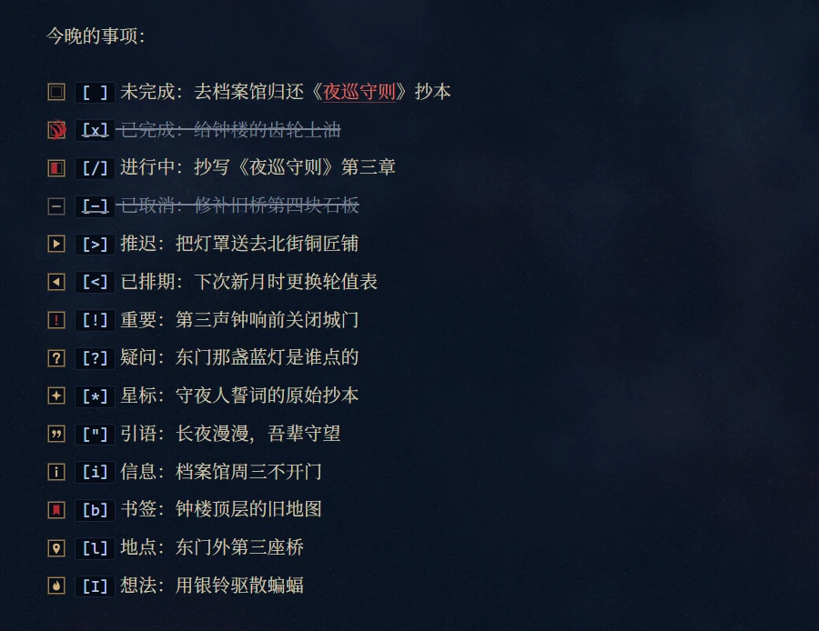

<h1 align="center">Nox Aeterna · 永夜</h1>

<em>一款哥特风格的 Obsidian 暗色主题，灵感来自《战锤 40K》的午夜领主。</em>

<a href="README.md">English</a> · 简体中文

## 特点

- 只有暗色。
- 兼顾中英文排版，中西文之间自动加间距。
- 字体全部内嵌，离线可用，不发出任何网络请求。
- 35 项 Style Settings 选项，设置页可显示中文或英文；大部分装饰都可以关掉。
- 为桌面端设计，在 Obsidian 1.14（Windows）上测试。

## 截图

用示例库 [`demo-vault/`](demo-vault) 截取。把这个文件夹当作仓库打开，就能亲手试用。

### 笔记

单张图片后面写 `|noframe` 就不加框。

### Callout

### 侧栏与标签

  
  &nbsp;&nbsp;
  

### 弹窗与空白标签页

## 安装

**在 Obsidian 里安装**：打开「设置 → 外观 → 主题 → 管理」，搜索 **Nox Aeterna**，点「安装并使用」。

**手动安装**：把 `theme.css` 和 `manifest.json` 复制到 `<你的库>/.obsidian/themes/Nox Aeterna/`，再到「设置 → 外观」里选择本主题。

**建议**：

- 安装 [Style Settings](https://github.com/mgmeyers/obsidian-style-settings) 插件，所有选项都在里面；不装时按默认值显示。
- 把「设置 → 外观 → 基础颜色方案」设为**暗色**，Excalidraw 等插件按它决定配色。

## Style Settings 选项

设置页最上面的「设置语言」可以切换中文或英文。括号里是默认值。

| 分组 | 选项 |
|---|---|
| 氛围 | 纹理及浓度（1）· 文件列表底部闪电纹及亮度（0.45）· 暗角及强度（0.62） |
| 装饰 | 标题装饰图 · 各级标题装饰 · 装饰分隔线 · Callout 装饰 · Callout 拉丁铭牌 · 卡片线框 · 侧栏卡片留白（8 px）· Callout 主题图标 / 原版图标 · 文件夹图标（3 种）· 大纲面板样式（3 种）· 图片样式（3 种）· 任务复选框主题样式 / 原版 · H1 与笔记标题左对齐 |
| 界面 | 自动隐藏正文顶栏 · 自动隐藏左侧功能栏 · 自动隐藏左下角仓库栏 · 自动收起侧栏面板按钮行（开）。隐藏的部分鼠标悬停时出现 |
| 排版 | 标题中文字体（思源宋体 / 汇文明朝体，需自行安装 / 华文宋体）· 正文行距（1.85）· 正文宽度（46rem，需打开「限制行宽」）· 正文对齐 · 中西文自动间距 · 弯引号用西文字形 · 界面使用无衬线字体 |
| 色彩 | 主强调色 `#b3262e` · 链接色 `#e8705f` · 黄铜 `#d2b07a` · 电光蓝 `#9dbbe8` · 笔记底色 `#0b1424` |

## 兼容性

- 只支持桌面端，移动端未测试。
- 中文优先使用本机安装的思源宋体（Noto Serif SC / Source Han Serif），没有安装时用内嵌的 6763 个常用字子集。
- 少数效果需要 Chromium 135 以上，即 Obsidian 1.12 及更新的安装包（版本见「设置 → 关于」）；旧安装包会退回较简单的样式。
- 常用的 Mermaid 图会改成主题配色，图里用 `classDef` 或 `style` 自定义的颜色依然优先。
- `theme.css` 约 5 MB，因为字体全部内嵌。

## 致谢

- **灵感来源**：[Fancy-a-Story](https://github.com/ElsaTam/obsidian-fancy-a-story)、[Baseline](https://github.com/aaaaalexis/obsidian-baseline)、[Maple](https://github.com/subframe7536/obsidian-theme-maple)。
- **图标**：[game-icons.net](https://game-icons.net)，作者 Lorc，[CC BY 3.0](https://creativecommons.org/licenses/by/3.0/) 授权，有修改：batwing-emblem、quill、scroll-unfurled、semi-closed-eye、tied-scroll、candle-light、laurels、claw-slashes、crossed-bones、skull-crossed-bones、spider-web、open-book、stiletto。
- **图形素材**：大纲骷髅取自 Heritage Library（HTC Heritage Type）；塔罗牌和空心骷髅取自 ICOOON MONO；午夜领主徽记取自社区图标集「wh_icons」。
- **字体**（SIL Open Font License 1.1）：EB Garamond、Cinzel、Manufacturing Consent、思源宋体 Noto Serif SC。

## 声明

本主题为非官方同人作品。《战锤 40K》、午夜领主及其徽记是 Games Workshop Ltd. 的商标。本主题与 Games Workshop 无关，也未经其认可。

## 许可

主题代码以 [MIT 许可证](LICENSE) 发布。第三方素材沿用各自的许可，见 [THIRD-PARTY-NOTICES.md](THIRD-PARTY-NOTICES.md)。
