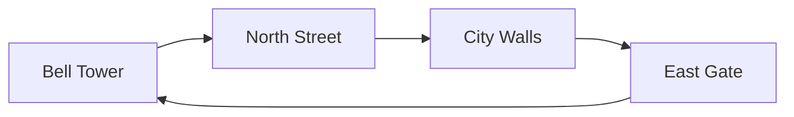

---
aliases:
  - Night Log
type: Journal
author: The Watchkeeper
date: 2026-10-22
pages: 128
archived: false
tags:
  - sample
  - gothic
  - night-watch
---

This is the sample note for the **Nox Aeterna** theme. It puts the common note styles on one page: **bold**, *italic*, ***bold italic***, ~~strikethrough~~, ==highlight==, `inline code`, an internal link to [[The Bell Tower]], an external link to [obsidian.md](https://obsidian.md), a #sample tag, and a footnote.[^1]

# I. The Sunless City

No one in the city has ever seen a sunrise. The sky is a single low sheet of lead, torn open only when the storms come. People keep time by the bells and divide the streets by lamplight; where the lamps go out, the Watch no longer holds sway (see [[The Rule of the Watch]]).

## The Bell Tower

> After the bell has struck thirteen, the gates open for no one.
> — *The Rule of the Watch*, article one

The tower stands at the heart of the old town. Its bronze bell is said to have been cast from the armour of the first watchkeepers. On every hour the toll runs down the cobbled streets to the foot of the walls.

### The Rule of Lamps

- Every street keeps at least one lamp burning
  - Neighbours take turns supplying the oil
    - The rota is posted on the west door of the tower
      - It changes at every new moon
  - Lamp hoods must be brass; glass shatters in the storms
- No raised voices after the lamps are out
- Meet a watchkeeper you do not know? Ask for the password first

The order of the round:

1. Leave [[The Bell Tower]] and walk [[North Street]] to the walls
2. Follow the walls halfway round and change guard at the [[East Gate]]
3. Return to the tower before dawn, if dawn ever comes

Tonight:

- [ ] `[ ]` To do: return *[[The Rule of the Watch]]* to the archive
- [x] `[x]` Done: oil the gears of the bell tower
- [/] `[/]` In progress: copy out chapter three of the Rule
- [-] `[-]` Cancelled: mend the flagstone on the old bridge
- [>] `[>]` Deferred: take the lamp hoods to the coppersmith
- [<] `[<]` Scheduled: change the rota at the new moon
- [!] `[!]` Important: close the gates before the third bell
- [?] `[?]` Question: who lit the blue lamp by the East Gate?
- [*] `[*]` Star: the original copy of the watchkeepers' oath
- ["] `["]` Quote: the night is long, and we keep watch
- [i] `[i]` Info: the archive is closed on Wednesdays
- [b] `[b]` Bookmark: the old map in the top room of the tower
- [l] `[l]` Location: the third bridge outside the East Gate
- [I] `[I]` Idea: scatter the bats with the silver bells

#### Watchkeeper's Kit

| Item | Use | Qty |
| :--- | :--- | ---: |
| Brass lantern | Light, and signalling | 1 |
| Iron whistle | Calling nearby watchkeepers | 2 |
| Vellum map | Marking the darkened streets | 1 |
| Silver bells | Scattering bats | 3 |

##### Note: The Bats of the Tower

A great colony of bats lives in the bell tower and pours out on the eve of a storm. The old watchkeepers say lightning strikes wherever the bats fly.

###### Sixth-level heading

The smallest heading, for the briefest of marginal notes.

## Storm Season

Storm season lasts only forty days a year, yet it accounts for half the city's legends. When lightning falls, the whole city turns bright as noon for less than a second. The last few nights are logged in [[2026-10-20]] and [[2026-10-21]].

> [!note]
> Count to seven between the flash and the thunder, and the storm is still beyond the walls.

> [!abstract]
> Forty days of storms, eleven strikes a night on average, most of them on the tower spire.

> [!info]
> The archive closes for storm season; borrow your copies early.

> [!todo]
> Inspect the copper lightning chains on the walls.

> [!important]
> On the worst night of the storms, every watchkeeper returns to the tower.

> [!tip]
> Trim the lantern wick short and the wind won't blow it out.

> [!success]
> Every chain at the East Gate has been replaced.

> [!question]
> Why has lightning never brought the tower down?

> [!warning]
> Never stand between the battlements during a storm.

> [!failure]
> The lamp on North Street went out again last night.

> [!danger]
> The old sewers flood in the rains. Do not go down.

> [!bug]
> The tower's striking gear runs three minutes fast.

> [!example]
> A password is a season and a metal, such as "frost and copper".

> [!quote]
> We keep watch in the dark so that others may sleep.

> [!tip]- A foldable callout (click to expand)
> A folded callout shows only its title until opened.

---

# II. The Archive

## Copies and Code

```python
def ring_bell(hour: int) -> str:
    # After thirteen strokes the gates close
    return "dong " * min(hour, 13)
```

```css
.night-watch {
  color: #e8dcc4;
  background: #0b1424;
}
```

## Formulae

Thunder delay and distance are roughly related by $d \approx 340\,t$ (metres).

$$
E = \sum_{i=1}^{n} \frac{q_i^2}{2C}
$$

## The Round



## The City by Moonlight

![[dresden-moonlight.jpg]]

*Johan Christian Dahl, View of Dresden by Moonlight, 1839. Public domain.*

## Embedding Another Note

![[The Bell Tower#The Toll]]

[^1]: This is a footnote. Footnotes are gathered at the end of the note.
